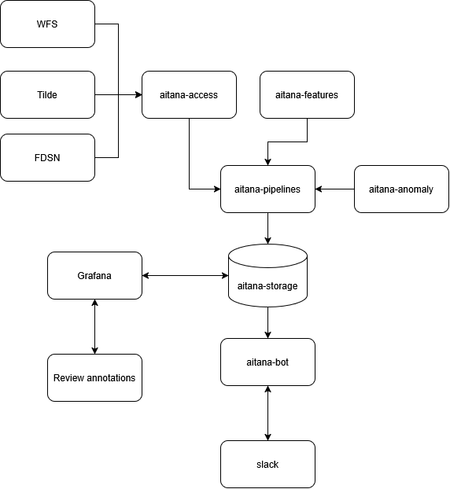

# Aitana: a human-in-the-loop framework for volcano monitoring

Aitana (named after the great football midfielder
[Aitana Bonmatí](https://en.wikipedia.org/wiki/Aitana_Bonmat%C3%AD)) is a prototype
framework for building, validating and operating AI/ML methods in volcano monitoring.

Aitana is a human-in-the-loop system with packages for data access,
feature computation, storage, modelling and evaluation as separate, independently installable pieces.

It is a monorepo of small Python distributions sharing one import namespace (`aitana.`).
Install only the parts you need; use them together as one system.

## The vision



*(The diagram source is [aitana.json](./aitana.json), editable with [draw.io](https://app.diagrams.net).)*

The target system is a closed loop, with `aitana-storage` as the hub:

1. **Ingest** — `aitana-access` pulls observations from GeoNet's Tilde API, the WFS
   earthquake catalogue and FDSN/S3 waveform archives.
2. **Compute** — `aitana-features` turns waveforms into features (RSAM, SSAM, DSAR,
   spectral and complex-trace attributes). It never fetches; it takes data in and returns
   results out.
3. **Store** — everything lands in `aitana-storage` as NetCDF/Zarr archives. It comes with a FastAPI endpoint that can serve datasets to Grafana.
4. **Detect** — `aitana-anomaly` runs a *panel* of state- and anomaly-detection algorithms
   over the stored features, each producing a comparable `[0,1]` anomaly index rather than
   one method being anointed as "the" detector.
5. **Benchmark** — `aitana-bench` scores those methods against real eruption catalogues and
   synthetic fault injection, through reproducible Snakemake workflows.
6. **Communicate** — `aitana-bot` provides a slack bot that sends notifications when anomalies are detected, and allows further investigation. It can also draft a daily "volcano weather report" and assists duty officers with on-demand eruption confirmation.
7. **Close the loop** — a human expert reviews what the system flagged. Their annotations flow back into `aitana-storage` as confirmed or revised labels, becoming ground truth for the next round of training and evaluation. Grafana provides the visual front end for that review.


## Architecture

Package boundaries are drawn along the **axis of change** — who has to change when X
changes, and which way dependencies point — not along a taxonomy of what the data is.
Two rules are load-bearing and enforced by [import-linter](https://import-linter.readthedocs.io)
contracts in [pyproject.toml](pyproject.toml):

1. **Dependencies point downward only.** Lower layers never import higher ones.
2. **Computation packages never fetch.** `features` operates on in-memory waveforms and must
   not import `access`. They are siblings that never import each other.

```
              aitana-bot                     duty-officer companion (planned)
                   │
                   ▼
            aitana-anomaly ──▶ aitana-bench  detection / benchmarking
                   │    │
                   ▼    ▼
        aitana-access aitana-features         siblings: I/O ── computation
                   │    |
                   ▼    ▼
             aitana-storage                   persistence
```

(Arrows are `depends on`. `aitana-bench` also depends on `aitana-storage` directly)

The `aitana-volcanoes` package is a convenience package that combines various datasets for a particular volcano.

The full reasoning — including namespace packaging (PEP 420), the many-distributions/one-repo
decision, and the PyPI publishing model — is in [Design.md](Design.md).

## Package status

| Distribution | Import package | Role | Status |
|---|---|---|---|
| [`aitana-storage`](aitana-storage/) | `aitana.storage` | NetCDF/Zarr feature archives, HTTP API, PyTorch datasets, Grafana annotations | Working (0.1.1) |
| [`aitana-access`](aitana-access/) | `aitana.access` | Pure I/O: Tilde, WFS, FDSN/S3/SDS waveforms | Working (0.1.2) |
| [`aitana-features`](aitana-features/) | `aitana.features` | RSAM, SSAM, DSAR, spectral & complex-trace features | Working (0.1.0) |
| [`aitana-volcanoes`](aitana-volcanoes/) | `aitana.volcanoes` | Ruapehu & Whakaari domain aggregates, eruption catalogues, Kalman fusion | Working (0.1.0) |
| [`aitana-bench`](aitana-bench/) | `aitana.bench` | `volcanobench` CLI, scoring, plotting, Snakemake workflows | Working (0.1.0) |
| [`aitana-anomaly`](aitana-anomaly/) | `aitana.anomaly` | State & anomaly detection expert panel | Partial — see below |
| [`aitana-bot`](aitana-bot/) | — | Duty-officer companion (VAB drafting, eruption confirmation) | Planned only ([PLAN.md](aitana-bot/PLAN.md)) |

## What is implemented

### `aitana-storage`
- `Storage` — hierarchical feature archives (site/sensor/channel) backed by NetCDF or Zarr,
  with gap filling, incremental merging and time-range queries.
- `TonikDataset` — PyTorch dataset yielding `[window_size, n_features]` windows with
  configurable stride.
- `tonik_api` — FastAPI service exposing `/feature`, `/inventory` and `/labels`.
- `grafana_annotations` — post stored labels to Grafana, or read annotations back.
- Background `IngestWorker` for queued dataset writes.

### `aitana-access`
- `tilde_request()` — GeoNet Tilde v4 observations (lake temperature and level, gas, GNSS,
  water chemistry).
- `wfs_request()` — GeoNet WFS earthquake catalogue by radius or polygon.
- `SeismicData` with pluggable clients tried in order: `S3Waveforms` (GeoNet's anonymous
  AWS Open Data bucket), `FDSNWaveforms`, `SDSWaveforms`, `MockSDSWaveforms`; includes
  validation, gap filling and instrument-response removal.
- `cache_dataframe()` — transparent disk caching with incremental date-range updates.
- `eqRate()` / `gradient()` — moving-window earthquake rate and trend estimation.
- `AitanaAPI` — FastAPI service adding `/waveform` and `/spectrogram`.

### `aitana-features`
RSAM (with wideband energy ratio), SSAM (filterbank and sonogram), DSAR, spectral features
(predominant/central frequency, bandwidth, cepstral coefficients), complex-trace attributes
(instantaneous frequency and bandwidth, normalised envelope, centroids), plus windowing and
stacking utilities and Matplotlib/Plotly visualisation.

### `aitana-volcanoes`
- **Ruapehu** — `CraterLake` (temperature, level), `Gas` (SO₂, CO₂, H₂S), `Seismicity`
  (regional and cone), `eruptions()`, `load_all()`, lake-height scaling.
- **Whakaari** — `Gas`, `Seismicity` (RSAM, quakes), `eruptions()`, `load_all()`.
- `assimilate` — state-space Kalman models: `SO2FusionModel` (multi-sensor SO₂ fusion),
  `LocalLinearTrend`, `SemiLinearTrend`.

### `aitana-bench`
- `volcanobench` CLI (`list` / `run` / `clean`) driving Snakemake workflows discovered via
  the `volcanobench.workflows` entry-point group — third-party packages can register their own.
- `scoring` — pre-eruption-window evaluation, TP/FP/TN/FN thresholding, ROC curves,
  forecasted-rate computation.
- `visualise` — `trellis_plot` (multi-panel time series with ensemble/uncertainty overlays)
  and `scoring_plot`.
- One bundled workflow: `egu2026`, a Bayesian network vs decision tree benchmark for Whakaari.

### `aitana-anomaly`
- `AnomalyDetectionBaseClass` — the shared contract every detector implements, including
  `normalize_score()`, the ECDF/percentile-rank normaliser that makes different algorithms'
  raw statistics comparable against a quiet reference period.
- `ZizouDataset` — feature loading and scaling for model input.
- `AutoEncoder` / `TiedAutoEncoder` — working per-timestep autoencoder with training,
  checkpointing and inference; `FuzzyCluster` for cluster assignment.
- `SNet` — scattering-network feature extraction (via `scatseisnet`).
- `evaluation` — the synthetic validation harness: `inject_faults()` (independent per-stream
  Bernoulli faults and coupled multi-stream faults), `inject_change_points()` (persistent
  regime shifts), `simulate_regime_series()` (synthetic data with known states) and
  `score_detector()` (ROC/AUC against the injected ground-truth mask). Documented with
  worked examples in [docs/evaluation_methods.qmd](aitana-anomaly/docs/evaluation_methods.qmd).

**Not yet working in `aitana-anomaly`:** no detector implements `compute_anomaly_index()` yet,
so the package does not currently produce a usable anomaly signal end to end. `pca.py` needs a
rewrite (its test suite is entirely skipped), and `SNet` has no downstream scoring layer.

## What is planned

### The expert panel (`aitana-anomaly`)

The research goal is to treat the volcano as a dynamical system with a hidden state vector,
detect recurring state regimes, and answer two operational questions directly: *"is this
normal?"* and *"when did it last look like this?"*. Rather than crowning a single best method,
four algorithms of increasing complexity run as an **expert panel**, and their agreement is
itself the signal:

| Algorithm | Rung |
|---|---|
| PCA + Hidden Markov Model | Baseline: orthogonal feature space with state propagation |
| 1D-convolutional autoencoder | Temporal dynamics over a sliding window |
| Scattering network + novelty detector | Waveform-level representation |
| ClaSP / CLaP state detection | Recurring-regime segmentation with transition structure |

Agreement is layered: per-algorithm alarm bits summed into a **vote count**, rolling rank
correlation as **consensus strength**, and inferred **state labels** as context against the
eruption chronology. Validation runs on two tracks — synthetic fault injection (as a
per-fault-type sensitivity diagnostic, not a leaderboard) and real eruption catalogues
(Whakaari 2018–2020 quantitatively; Ruapehu's H1 2022 unrest as a qualitative case study).

The phased roadmap, the manuscript-oriented tables and figures, and the reasoning behind each
choice are in [aitana-anomaly/PLAN.md](aitana-anomaly/PLAN.md).

### The duty-officer companion (`aitana-bot`)

Two capabilities, deliberately different architectures, both Ruapehu-first:

- **Volcanic Activity Bulletins** — a linear pipeline (fetch → digest to statistics → one
  structured LLM call → provenance check) that drafts a daily report. Three rules are enforced
  structurally, not by prompt: the agent never infers the Volcanic Alert Level (it transcribes
  it from meeting notes), raw time series never reach the LLM, and everything produced is a
  draft with no auto-publish path.
- **Eruption confirmation** — an on-demand agentic tool loop (webcam imagery, seismic and
  infrasound data, anomaly baselines) that produces a hedged, evidence-cited *assessment*.
  The output schema has no boolean verdict field; the full tool-call transcript is logged as
  an audit trail.

Details, milestones and open questions for the volcano team are in
[aitana-bot/PLAN.md](aitana-bot/PLAN.md). Note the directory is `aitana-bot` while the plan
proposes distribution name `aitana-virtual-volcanologist` — the naming is not yet settled.

### Cross-cutting

- A `camera` module in `aitana-access` for GeoNet webcam imagery (same S3 bucket as waveforms).
- Cadence alignment: resampling all streams onto a shared 10-minute grid in `aitana-access`
  and `aitana-features`.
- Temporal cross-validation schemes and proper scoring rules (log-likelihood, CRPS,
  reliability diagrams).
- Semantic versioning of datasets and evaluation protocols.
- Integration with community tools (SeisBench, WOVOdat formats).

## Design documents

| Document | Subject |
|---|---|
| [Design.md](Design.md) | Architecture, package boundaries, namespace packaging, publishing |
| [aitana-anomaly/PLAN.md](aitana-anomaly/PLAN.md) | State & anomaly detection roadmap (the expert panel) |
| [aitana-bot/PLAN.md](aitana-bot/PLAN.md) | Duty-officer companion: VAB drafting and eruption confirmation |
| [aitana-anomaly/DBN.md](aitana-anomaly/DBN.md) | Hill et al. — Bayesian anomaly detection for sensor data; source of the fault-injection protocol |
| [aitana-anomaly/blended-regime-state-space-model.md](aitana-anomaly/blended-regime-state-space-model.md) | Switching state-space model for gradual multi-sensor transitions |
| [aitana-anomaly/carniel-1996-methodology-summary.md](aitana-anomaly/carniel-1996-methodology-summary.md) | Carniel (1996) — delay embedding and neural change detection for tremor |
| [aitana-anomaly/docs/evaluation_methods.qmd](aitana-anomaly/docs/evaluation_methods.qmd) | Worked examples of the synthetic evaluation harness |

## Installation

Each distribution installs independently with its own narrow dependency set — installing
`aitana-features` gets you numpy/scipy/obspy, not the FDSN clients or storage backends:

```bash
pip install aitana-storage     # feature archives + HTTP API only
pip install aitana-features    # feature computation only
pip install aitana-access      # I/O only (pulls storage)
pip install aitana-volcanoes   # per-volcano aggregates (pulls access + features)
pip install aitana-bench       # benchmarking CLI
```

`aitana-anomaly` is not published yet — install it from the workspace (see below).

They share the `aitana.` namespace, so installing several gives you
`import aitana.access`, `import aitana.features`, and so on. There is no parent `aitana`
distribution.

### Development

The repo is a [uv](https://docs.astral.sh/uv/) workspace with a single lockfile:

```bash
git clone https://github.com/tsc-tools/aitana.git
cd aitana
uv sync                    # installs all distributions in editable mode
uv run pytest              # run the test suite
uv run lint-imports        # check the layering contracts
```

A [devcontainer](.devcontainer/devcontainer.json) is provided with the full toolchain
(uv, Apptainer, Quarto, Node) preinstalled.

## `volcanobench` CLI

The `volcanobench` command drives Snakemake benchmarking workflows bundled with Aitana
or registered by third-party packages via the `volcanobench.workflows` entry-point group.

### Commands

| Command | Description |
|---|---|
| `volcanobench list` | List all registered workflows (name, volcano, description). |
| `volcanobench run <volcano> <outdir>` | Run every registered workflow for a volcano. |
| `volcanobench clean <volcano> <outdir>` | Delete all outputs produced by the workflow. |

`volcanobench run` accepts `--cores N` (default `1`) to control Snakemake parallelism.

### Examples

```bash
# See what workflows are available
volcanobench list

# Run the Whakaari Bayesian-network benchmark, writing results to ./results
volcanobench run whakaari ./results

# Run with 4 parallel cores
volcanobench run whakaari ./results --cores 4

# Remove all outputs
volcanobench clean whakaari ./results
```

### Bundled workflows

| Name | Volcano | Description |
|---|---|---|
| `egu2026` | whakaari | Bayesian network vs decision tree benchmark for Whakaari/White Island (EGU 2026) |

### Running the EGU 2026 workflow with Docker

`scripts/run_egu2026.sh` is a convenience wrapper that builds the project's Docker image,
installs Aitana from source inside the container, and runs the bundled `egu2026` workflow —
no local Python environment needed.

**Prerequisites:** Docker must be installed and running.

```bash
# Run with defaults (output → ./egu_2026_output, all available cores)
./scripts/run_egu2026.sh

# Custom output directory and core count
./scripts/run_egu2026.sh -o /data/results -c 8

# Show help
./scripts/run_egu2026.sh -h
```

| Option | Default | Description |
|---|---|---|
| `-o OUTDIR` | `./egu_2026_output` | Directory for workflow outputs |
| `-c CORES` | all logical CPUs | Snakemake parallelism |

The Docker image (`aitana-workflow`) is built from `docker/Dockerfile` on first run and
cached by Docker. Conda environments for individual workflow rules are cached in a named
Docker volume (`aitana-conda-envs`) and reused across runs, so subsequent invocations are
significantly faster.

The poster-generation step uses Apptainer inside Docker (to run an Inkscape container),
which requires elevated capabilities (`SYS_ADMIN`, `/dev/fuse`). These are passed
automatically by the script.

### Registering your own workflow

Any Python package can register a workflow by exposing a `WorkflowDescriptor` instance
under the `volcanobench.workflows` entry-point group:

```toml
# pyproject.toml
[project.entry-points."volcanobench.workflows"]
my_workflow = "my_package.workflows:my_workflow"
```

```python
# my_package/workflows.py
from pathlib import Path
from aitana.bench.volcanobench import WorkflowDescriptor

my_workflow = WorkflowDescriptor(
    name="my_workflow",
    volcano="ruapehu",
    description="My custom eruption forecast model",
    workflowdir=Path(__file__).parent / "snakemake",
    outputs={
        "forecast": "results/forecasts.nc",
    },
)
```

The workflow directory must contain a `Snakefile`. Aitana copies it into `outdir` before
execution, so the original is never modified.

## Documentation

Learn more in the official [documentation](https://tsc-tools.github.io/aitana/).
Try out a [Jupyter notebook](https://github.com/tsc-tools/aitana/blob/main/docs/aitana_example.ipynb).

## Get in touch

Report bugs, suggest features, view the source code, and ask questions
[on GitHub](https://github.com/tsc-tools/aitana/issues).
